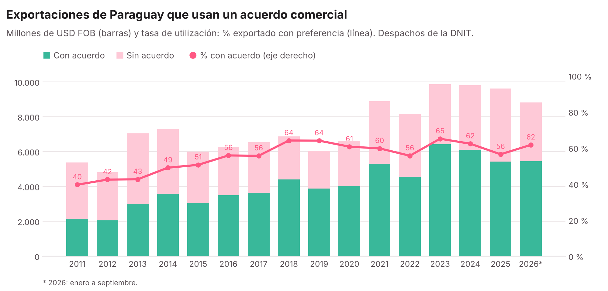
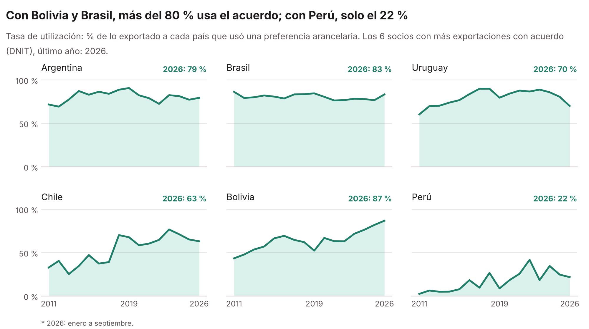
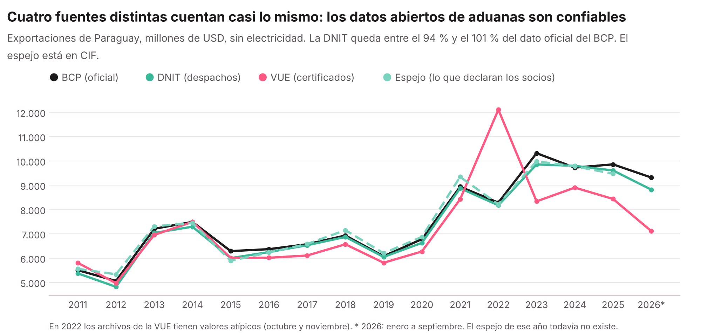
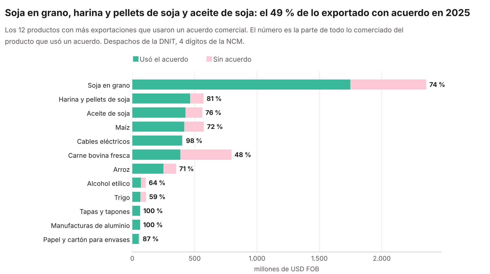
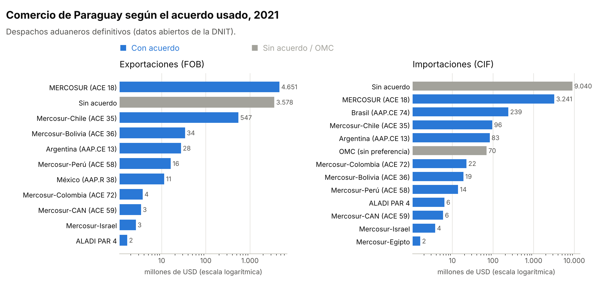

<div align="center">

# Comercio exterior de Paraguay por acuerdo comercial

**¿Cuánto exporta e importa Paraguay usando efectivamente cada acuerdo comercial?**<br>
Con datos abiertos de la DNIT (aduanas), la VUE (MIC), el BCP y UN Comtrade, 2011–2026.<br>
Por país, por producto y por acuerdo, con una [página web](https://silvia-mov.github.io/comercio-exterior-paraguay-dnit-mic/) con buscadores en lenguaje simple.


[Página web](https://silvia-mov.github.io/comercio-exterior-paraguay-dnit-mic/) · [Utilización 2011–2026](#utilización-de-los-acuerdos-20112026) · [Para qué sirve](#para-qué-sirve) · [Inicio rápido](#inicio-rápido) · [Datos](#tres-formas-de-conseguir-los-datos) · [Glosario](docs/GLOSARIO.md)

</div>

---

## Utilización de los acuerdos, 2011–2026

<picture>
  <source media="(prefers-color-scheme: dark)" srcset="docs/img/utilizacion_anual_dark.png">
  
</picture>

<picture>
  <source media="(prefers-color-scheme: dark)" srcset="docs/img/utilizacion_socios_dark.png">
  
</picture>

La **tasa de utilización** es la parte de lo exportado que usó efectivamente una preferencia de un
acuerdo comercial: pasó de **40 % en 2011 a 56–65 % desde 2016**. Se calcula con los despachos de
la DNIT (numerador y denominador de la misma fuente). 2026: enero a septiembre.

### Las cuatro fuentes coinciden

<picture>
  <source media="(prefers-color-scheme: dark)" srcset="docs/img/fuentes_dark.png">
  
</picture>

| Fuente | Qué mide | Detalle |
|---|---|---|
| **DNIT** | Despachos de aduana: regímenes definitivos, destino declarado, con o sin acuerdo | NCM 8 dígitos |
| **VUE** (MIC) | Certificados de origen emitidos: destino final | Partida (4 dígitos) |
| **BCP** (SICEX) | Estadística oficial: todos los regímenes, destino final, incluye electricidad | NCM 8 dígitos |
| **Espejo** (UN Comtrade) | Lo que cada país declara haber comprado a Paraguay (CIF) | SA 6 dígitos |

Sin electricidad, la DNIT queda entre el 94 % y el 101 % del total oficial del BCP en todos los
años, y el espejo entre el 94 % y el 106 %: los datos abiertos de aduanas sirven para medir el
comercio. La VUE se aparta en 2022 (valores atípicos en sus archivos) y desde 2023 cubre menos.

```bash
python python/cruzar_fuentes.py          # salidas/Cruce_4_fuentes.xlsx
python docs/figuras_cruce.py             # gráficos de esta sección
```

Hojas: *Por año*, *Utilización por socio*, *Por país*, *Por partida* y *Notas*. Los datos del BCP
están en [`datos_bcp/`](datos_bcp/LEEME.md) y los datos espejo de UN Comtrade en
[`datos_comtrade/`](datos_comtrade/LEEME.md) (fuente: UN Comtrade). Para actualizarlos:
`python/descargar_comtrade.py --espejo` (necesita una clave de UN Comtrade; la gratuita alcanza).

## Productos que más usan los acuerdos

<picture>
  <source media="(prefers-color-scheme: dark)" srcset="docs/img/productos_exportacion_dark.png">
  
</picture>

Para cada producto (4 y 8 dígitos de la NCM) y año: cuánto se comerció, qué parte usó un acuerdo y
cuál fue el acuerdo principal. Sale directamente del campo "acuerdo" de cada despacho; no usa las
listas de productos con preferencia de cada acuerdo, así que no dice qué productos *podrían* usar un
acuerdo y no lo usan. En la [página web](https://silvia-mov.github.io/comercio-exterior-paraguay-dnit-mic/#productos)
hay un buscador ("soja", "carne", "yerba" o un código NCM).

```bash
python python/resumen_productos.py datos_dnit --anios 2021   # salidas/productos/ (un año por vez)
python python/productos_acuerdos.py                          # salidas/Productos_acuerdos.xlsx y docs/datos/
python docs/figuras_productos.py                             # gráficos de esta sección
```

Los nombres cortos de los productos ("Soja en grano", "Carne bovina fresca") están en
`config/nombres_cortos_ncm.csv` y se pueden ampliar.

### Excel por año para descargar

En `docs/descargas/` hay un Excel por año (2011–2026) de cada fuente, en Calibri 10, con tres hojas:
**Datos**, **Tabla dinámica** (ya armada) y **Notas**. DNIT: resumen por producto (NCM 8 dígitos),
país y acuerdo (los despachos completos superan el millón de filas de Excel). BCP: SICEX por mes,
producto y país. VUE: los 12 archivos mensuales unidos, sin cambiar los valores. Se rehacen con:

```bash
python python/excel_descargas.py      # después de docs/datos_web.py y python/productos_acuerdos.py
```

La tabla dinámica la arma `python/tabla_dinamica.py` con LibreOffice (requiere `soffice` y `python3-uno`).

## Comercio según el acuerdo usado, año por año

Un gráfico por año, de exportaciones (FOB) e importaciones (CIF) según el acuerdo usado en el despacho:
[2011](docs/img/acuerdos_2011_light.png) · [2012](docs/img/acuerdos_2012_light.png) · [2013](docs/img/acuerdos_2013_light.png) · [2014](docs/img/acuerdos_2014_light.png) · [2015](docs/img/acuerdos_2015_light.png) · [2016](docs/img/acuerdos_2016_light.png) · [2017](docs/img/acuerdos_2017_light.png) · [2018](docs/img/acuerdos_2018_light.png) · [2019](docs/img/acuerdos_2019_light.png) · [2020](docs/img/acuerdos_2020_light.png) · [2021](docs/img/acuerdos_2021_light.png) · [2022](docs/img/acuerdos_2022_light.png) · [2023](docs/img/acuerdos_2023_light.png) · [2024](docs/img/acuerdos_2024_light.png) · [2025](docs/img/acuerdos_2025_light.png) · [2026](docs/img/acuerdos_2026_light.png) (2026: enero a octubre). También en la [página web](https://silvia-mov.github.io/comercio-exterior-paraguay-dnit-mic/#por-acuerdo), con un selector de años.

Se generan con `python docs/figuras.py` a partir de `salidas/por_acuerdo/` (un resumen por año de `procesar_despachos.py`).

## Para qué sirve

Para medir, con **datos abiertos y métodos públicos**, cuánto exporta e importa Paraguay
**usando efectivamente cada acuerdo comercial**, y compararlo con el comercio sin preferencia.

- **Abierto**: usa solo los datos públicos de la DNIT; cualquiera puede repetir los cálculos.
- **Transparente**: cada decisión (qué regímenes se cuentan, cómo se agrupan los acuerdos, qué
  se excluye y por qué) está escrita en el [Glosario](docs/GLOSARIO.md) y en archivos de
  configuración que se pueden revisar y cambiar sin programar.
- **Verificable**: la hoja *Control* muestra todo lo que se dejó afuera, y el código está en
  Python y en R con resultados idénticos.
- **Actualizable**: cada mes nuevo que publica la DNIT se agrega con un comando.

Puede usarse como herramienta principal o **para validar y complementar otras bases de
comercio exterior**.

**Todas las definiciones y decisiones están explicadas en el [Glosario](docs/GLOSARIO.md).**

Las versiones **Python** y **R** aplican la misma metodología, leen la misma configuración y
producen el mismo reporte (verificado con los 12 meses de 2021: mismos valores en todas las hojas).

## Ejemplo: un año en detalle (2021)

<picture>
  <source media="(prefers-color-scheme: dark)" srcset="docs/img/acuerdos_2021_dark.png">
  
</picture>

| | Con acuerdo | Sin acuerdo | Total | % con acuerdo |
|---|---:|---:|---:|---:|
| **Exportaciones** (FOB) | USD 5.299 M | USD 3.578 M | USD 8.877 M | **59,7 %** |
| **Importaciones** (CIF) | USD 3.732 M | USD 9.110 M | USD 12.842 M | **29,1 %** |

<sub>"Con acuerdo" = el despacho usó una preferencia: MERCOSUR (ACE 18), acuerdos del MERCOSUR con
terceros y acuerdos ALADI. Sin electricidad (no pasa por la aduana). Detalle en el [Glosario](docs/GLOSARIO.md).</sub>

## Estructura

```
├── python/procesar_despachos.py   # versión Python (pandas)
├── python/descargar_dnit.py       # descarga los meses de la DNIT (o del respaldo)
├── R/procesar_despachos.R         # versión R / RStudio (data.table)
├── comercio-exterior-paraguay-dnit-mic.Rproj   # abrir en RStudio
├── config/
│   ├── acuerdos.csv               # cómo se agrupa cada valor de "acuerdo" de la DNIT
│   ├── regimenes.csv              # qué regímenes aduaneros se consideran definitivos
│   ├── columnas.csv               # qué columnas lleva la hoja "Detalle" (SI / NO)
│   ├── paises_vue.csv             # nombres de países de la VUE -> código de país de la DNIT
│   └── nombres_cortos_ncm.csv     # nombres en lenguaje común de las partidas más frecuentes
├── python/leer_vue.py             # junta los archivos de la VUE en una tabla
├── python/cruzar_dnit_vue.py      # cruce DNIT (despachos) vs. VUE (certificados de origen)
├── python/leer_bcp.py             # lee los reportes del SICEX del BCP
├── python/descargar_comtrade.py   # descarga UN Comtrade por API (datos de Paraguay y espejo)
├── python/cruzar_fuentes.py       # cruce de las cuatro fuentes y tasa de utilización
├── python/resumen_productos.py    # resumen por producto (NCM) de un año de despachos
├── python/productos_acuerdos.py   # productos que más usan los acuerdos
├── datos_bcp/<año>/               # exportaciones mensuales del BCP (SICEX), 2011–2026, NCM 8 dígitos
├── datos_comtrade/espejo/         # lo que los socios declaran comprar a Paraguay (UN Comtrade), 2011–2025
├── datos_vue/<año>/               # certificados de origen de la VUE, 2011–2026 (archivos mensuales)
├── CHANGELOG.md                   # versiones del código y qué incluye cada una
├── docs/GLOSARIO.md               # qué significa cada término, columna y decisión
├── docs/figuras.py                # gráficos del README (docs/img/)
├── docs/figuras_cruce.py          # gráficos del cruce de las cuatro fuentes
├── docs/figuras_productos.py      # gráficos de productos
├── docs/consulta_web.py           # datos del buscador por país de la página
├── docs/index.html                # página web del proyecto (GitHub Pages)
├── docs/datos_web.py              # archivos para descargar desde la página (docs/datos/)
├── docs/descargas/                # un Excel por año y fuente, con tabla dinámica
├── python/excel_descargas.py      # arma esos Excel (python/tabla_dinamica.py agrega la tabla)
├── datos_ejemplo/                 # muestra pequeña y real (enero 2025) para probar
└── datos_dnit/                    # AQUÍ van sus archivos reales (no se suben a GitHub)
```

## Inicio rápido

1. Descargue o clone el repositorio (botón verde **Code → Download ZIP**).
2. Pruebe con la muestra incluida:

   **Python**
   ```bash
   pip install -r python/requirements.txt
   python python/procesar_despachos.py datos_ejemplo
   ```

   **R / RStudio**
   - Abra `comercio-exterior-paraguay-dnit-mic.Rproj` en RStudio (fija el directorio de trabajo).
   - Abra `R/procesar_despachos.R`, cambie `RUTA_DATOS <- "datos_ejemplo"` y presione **Source**.
   - O por consola: `Rscript R/procesar_despachos.R datos_ejemplo`

3. El reporte queda en `salidas/Reporte_Comercio_Paraguay_Acuerdos.xlsx`.

## Fuente de los datos

Datos abiertos de la **Dirección Nacional de Ingresos Tributarios (DNIT) – Gerencia General de
Aduanas**: <https://www.dnit.gov.py/web/portal-institucional/datos-abiertos> (despachos aduaneros,
archivos mensuales "Nivel Item").

Copias de los archivos mensuales están en las
[releases de este repositorio](https://github.com/silvia-mov/comercio-exterior-paraguay-dnit-mic/releases)
(una release por año, por ejemplo `datos-2021`).

## Tres formas de conseguir los datos

| | Cómo | Para quién |
|---|---|---|
| **1. Releases de este repositorio** | Entrar a [Releases](https://github.com/silvia-mov/comercio-exterior-paraguay-dnit-mic/releases), bajar los meses y copiarlos en `datos_dnit/`. | Quien quiere pocos meses, sin usar código. Es además el **respaldo**: copias guardadas aquí por si el portal de la DNIT se cae o cambia de dirección. |
| **2. Script de descarga** | `python python/descargar_dnit.py --anios 2021` | Quien quiere muchos meses. Baja de la DNIT y, si falla, del respaldo en las releases. |
| **3. Portal de la DNIT a mano** | [Datos Abiertos](https://www.dnit.gov.py/web/portal-institucional/datos-abiertos) → Descargas → año → mes → CSV "Nivel Item". | Siempre disponible, mes por mes. |

### El script de descarga

```bash
python python/descargar_dnit.py --listar                         # qué años y meses publica la DNIT
python python/descargar_dnit.py --anios 2021                     # un año completo
python python/descargar_dnit.py --anios 2019-2021 --meses enero  # varios años, un mes
python python/descargar_dnit.py --anios 2021 --fuente github     # solo del respaldo
```

- Guarda los archivos en `datos_dnit/<año>/` (no se suben a GitHub).
- Si un mes ya está bajado (mismo tamaño), lo salta.
- El portal de la DNIT publica desde **enero de 1997**. Cada mes pesa entre 100 y 160 MB y
  puede tardar varios minutos; la serie completa son decenas de GB.
- No necesita instalar nada: usa solo la biblioteca estándar de Python.
- Cómo funciona: el portal tiene una lista pública de sus archivos
  (`https://datosabiertos.aduana.gov.py/ddaa/mainctrl/listaArchivos`), la misma que usa la
  página para armar los botones de "Descargar", y cada archivo tiene una dirección fija
  (p. ej. `https://datosabiertos.aduana.gov.py/all_data/2021/ENERO/2021_ENERO_Nivel_Item.csv`).

## Usar los datos reales

Los archivos de la DNIT pesan mucho más que los 25 MB que GitHub permite subir por la web,
por eso **no forman parte del repositorio**. Cada persona descarga los archivos de la DNIT y:

- los copia en la carpeta `datos_dnit/` (puede usar subcarpetas por año), **o**
- edita la ruta al inicio del script:

  ```python
  RUTA_DATOS = r"C:\Users\usuario\Descargas\dnit"     # Python
  ```
  ```r
  RUTA_DATOS <- "C:/Users/usuario/Descargas/dnit"     # R (use / en lugar de \)
  ```

- o pasa la ruta al ejecutar: `python python/procesar_despachos.py "D:/dnit/2025"`.

### Elegir años y meses

```bash
python python/procesar_despachos.py datos_dnit --anios 2021 --meses todos
python python/procesar_despachos.py datos_dnit --anios 2019-2023
python python/procesar_despachos.py datos_dnit --anios 2024 --meses enero,febrero,marzo
```

En R es igual:

```bash
Rscript R/procesar_despachos.R datos_dnit --anios 2021 --meses todos
```

o, en RStudio, editar `ANIOS <- 2021` y `MESES_ELEGIDOS <- "TODOS"` al inicio del script.

Sin `--anios` se juntan todos los años de la carpeta. Los archivos de otros períodos ni
siquiera se abren (el programa mira el nombre, p. ej. `2021_ENERO_Nivel_Item.csv`).

### Elegir las columnas

En [`config/columnas.csv`](config/columnas.csv), poner `SI` o `NO` en la columna `incluir`
(se puede editar en Excel). Por defecto el reporte lleva solo el **valor en dólares**: FOB en
exportaciones y CIF en importaciones (`VALOR_DOLAR`).

El script procesa **todos** los archivos `.json`, `.txt`, `.csv`, `.xlsx` y `.parquet` de la
carpeta (y sus subcarpetas) y los consolida en un solo reporte.

> **No copie los archivos a mano en el Bloc de notas.** El JSON de la DNIT tiene una sola
> línea de varios MB y al copiarlo suele quedar cortado. Use el archivo descargado tal cual.
> (La versión Python igual intenta recuperar los despachos completos de un archivo cortado
> y avisa cuántos leyó.)

### ¿Qué archivo descargar?

El portal de Datos Abiertos de la DNIT ofrece, por mes, dos niveles y varios formatos. Tamaños
de referencia para enero 2025:

| Nivel | Formato | Tamaño | Comentario |
|---|---|---|---|
| Nivel Item | CSV | ~210 MB | **Recomendado.** Una fila por item. ~20 s y <1 GB de RAM por mes |
| Nivel Item | XLSX | ~56 MB | Una fila por item. Más lento de leer |
| Nivel Sub Item | CSV | ~465 MB | Una fila por sub-item: los valores del item se repiten en cada fila |
| Nivel Sub Item | JSON | ~331 MB | Despacho → items → subitems. Requiere varios GB de RAM |
| Nivel Sub Item | XLSX | ~106 MB | |

Todos traen la misma información de valores, porque **los montos (FOB, flete, seguro, tributos)
están a nivel item**: el nivel sub item solo agrega el detalle de la mercadería (cantidad,
precio unitario, marca). Por eso el script trabaja siempre a nivel item y nunca suma
sub-items. **Descargue un solo formato por mes.** Si hay dos archivos del mismo mes, los items
repetidos se detectan (por despacho + número de item) y se cuentan una sola vez.

Recomendación: use el **CSV de Nivel Item**. Es el más liviano de procesar (el script lee
solo las columnas necesarias). El CSV de sub item también da resultados correctos porque el
script deja una sola fila por item, pero es más pesado. El JSON de ~330 MB requiere varios GB
de memoria RAM; si su equipo tiene poca, procese los meses de a uno.

### ¿Cómo compartir los datos completos? (GitHub Releases)

El límite de 25 MB es solo para subir archivos **desde la web al repositorio**. GitHub tiene
otra función, **Releases** ("versiones publicadas"), pensada para adjuntar archivos grandes:

- Es **gratis** en repositorios públicos.
- Cada archivo adjunto puede pesar **hasta 2 GB**, y no hay límite al total de la release ni a
  las descargas.
- Los archivos no forman parte del código (no hacen pesado el `git clone`), pero quedan con un
  enlace de descarga permanente junto al repositorio.

Cómo hacerlo:

1. Comprima cada archivo en `.zip` (los CSV y JSON se reducen mucho, a menudo a la décima parte).
2. En el repositorio, a la derecha, entre a **Releases → Create a new release**
   (o `https://github.com/<usuario>/<repo>/releases/new`).
3. En **Choose a tag** escriba un nombre nuevo, por ejemplo `datos-2025`, y elija *Create new tag*.
4. Ponga un título ("Datos DNIT 2025"), arrastre los `.zip` a la zona *Attach binaries* y
   presione **Publish release**.
5. Quien use el repositorio descarga los `.zip` de la release, los descomprime en
   `datos_dnit/` y ejecuta el script.

Otras opciones: **Git LFS** (versiona archivos grandes dentro del repositorio, pero la cuota
gratuita de almacenamiento y descargas es limitada) o simplemente enlazar al portal oficial de
la DNIT para que cada usuario descargue la versión vigente.

## Cruce con los certificados de origen (VUE)

```bash
python python/cruzar_dnit_vue.py --anios 2020-2021
```

Compara, por **año, país de destino y partida** (4 dígitos de la NCM), el valor FOB de los
certificados de origen de la VUE (carpeta `datos_vue/`) con las exportaciones de la DNIT, separadas
en con acuerdo y sin acuerdo. Resultado: `salidas/Cruce_DNIT_VUE.xlsx` (hojas *Por año*,
*Por país*, *Por partida*, *País y partida* y *Notas*). Necesita los archivos de la DNIT de esos
años en `datos_dnit/`.

Los países se cruzan por el código de la DNIT; las equivalencias de nombres (por ejemplo,
"HOLANDA" en la VUE es `NL - PAISES BAJOS` en la DNIT) están en `config/paises_vue.csv`.

**No son fuentes equivalentes**: la VUE cuenta todos los certificados de origen (no solo los de
acuerdos), fecha por emisión del certificado y usa el destino final. Ver el
[Glosario](docs/GLOSARIO.md#8-datos-de-la-vue-certificados-de-origen).

## Metodología

Cada item de cada despacho pasa por estos filtros (en este orden). Lo que se excluye y el
motivo queda registrado en la hoja **Control** del reporte.

1. **Operación**: importación o exportación.
2. **Régimen definitivo**: solo los códigos marcados `SI` en `config/regimenes.csv`
   (se excluyen temporales, depósitos, ingresos a zona franca, etc.).
3. **Origen de exportaciones**: en exportaciones solo se cuenta mercadería de origen
   paraguayo (configurable con `EXPORTACIONES_SOLO_ORIGEN_PARAGUAY`).
4. **Acuerdo comercial**: el valor `acuerdoAjustado` de la DNIT se agrupa según
   `config/acuerdos.csv` en un acuerdo consolidado y un **tipo**:
   - `PREFERENCIAL`: negociado por un acuerdo comercial (ALADI, Mercosur-Chile, etc.).
   - `SIN_ACUERDO`: sin preferencia (OMC / NMF).
   - `MERCOSUR_INTRAZONA`: comercio intra-Mercosur (ACE 18).

   Con `TIPOS_ACUERDO_INCLUIDOS` se elige qué tipos se conservan. Por defecto los tres, para
   poder calcular el total de cada año. **"Con acuerdo" = `PREFERENCIAL` + `MERCOSUR_INTRAZONA`.**

Los regímenes **EFC1** (exportación complementaria) e **IFC1** (importación de fracciones
complementarias) se excluyen porque repiten el valor de un despacho principal ya contado.
La explicación, con ejemplos, está en el [Glosario](docs/GLOSARIO.md#por-qué-se-excluyen-efc1-e-ifc1).

**Cálculos** (todo en USD):

| Variable | Cálculo |
|---|---|
| `FOB_DOLAR` | FOB declarado (USD) |
| `CIF_DOLAR` | FOB + flete + seguro (solo importaciones) |
| `IMPONIBLE_DOLAR` | imponible de la DNIT (en Gs.) ÷ cotización del despacho |
| `DERECHO`, `TRIBUTOS_INTERNOS` | montos en Gs. ÷ cotización. Internos = IVA + ISC + servicio + renta + otros |
| `PRESION_*_PCT` | tributo ÷ imponible × 100, calculado sobre los totales agregados |
| `CONTEO_DESPACHOS` | cantidad de despachos distintos en el grupo |

### Hojas del reporte

- **Totales por año**: por año y operación, el valor con acuerdo, sin acuerdo, el total y el
  % con acuerdo. Es la base para los gráficos.
- **Por acuerdo**: por año y operación, el valor de cada acuerdo.
- **Detalle**: las columnas elegidas en `config/columnas.csv` (por defecto: año, operación,
  acuerdo, país, NCM y descripción). Si supera el límite de filas de Excel se guarda aparte en
  Parquet (o CSV comprimido).
- **Control**: items incluidos y excluidos por motivo, régimen y acuerdo, con su valor FOB.
  Sirve para verificar que no se esté perdiendo comercio relevante.

## Mantener la configuración

Si la DNIT agrega un régimen o un nombre de acuerdo nuevo, el script lo avisa en pantalla y
en la hoja Control (`REGIMEN_EN_CONFIG = NO` / `ACUERDO_EN_CONFIG = NO`). Basta con agregar
una fila al CSV correspondiente; no hace falta tocar el código:

- `config/regimenes.csv`: `codigo,incluir,descripcion,nota` (`incluir` = `SI` / `NO`).
- `config/acuerdos.csv`: `acuerdo_dnit,acuerdo_consolidado,tipo`.

Los regímenes que no figuran en `regimenes.csv` se excluyen. Los acuerdos que no figuran en
`acuerdos.csv` se tratan como `PREFERENCIAL` con la etiqueta "Otro acuerdo (sin clasificar)".

## Verificación

Verifique siempre los totales contra las estadísticas oficiales publicadas (por ejemplo, las
del BCP **sin energía eléctrica**, que no pasa por estos despachos). Para 2021 el programa da
exportaciones por USD 8.877 millones (FOB) e importaciones por USD 12.842 millones (CIF).

## Licencia

Código bajo licencia [MIT](LICENSE): cualquiera puede usarlo, copiarlo y modificarlo citando la fuente.
